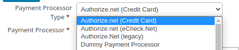
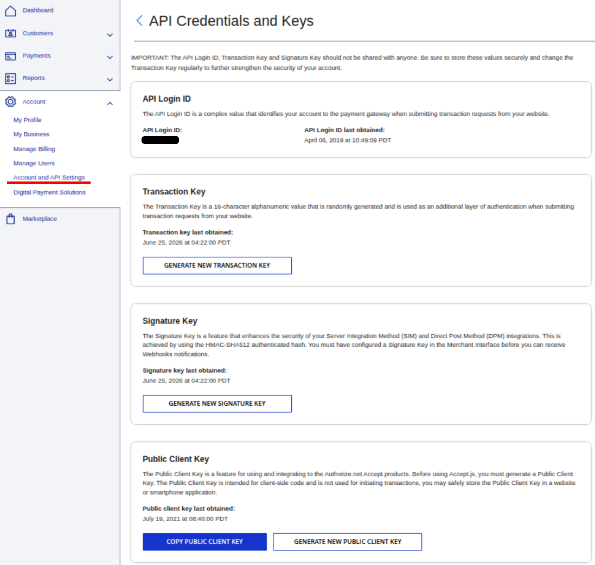
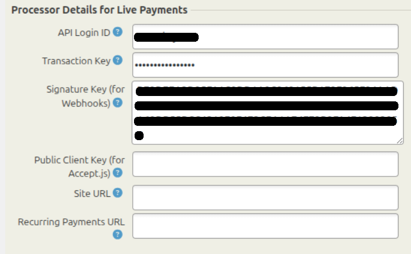

# Setup

## Configure Payment Processor

This extension provides three payment processors:

* Authorize.net (Credit Card).
* Authorize.net (eCheck.Net/ACH).
* Authorize.net (Accept.js).

The older core payment processor Authorize.net (legacy), if available, should not be used.

## Authorize.net API credentials

Each payment processor can be configured with the same API credentials.

Login to your Authorize.net dashboard and select *Account*->*API Credentials and Keys*:

Generate and get your API Login ID, Transaction Key and Signature Key.

For Accept.js you also need to generate a "Public Client Key".

Now create a payment processor in CiviCRM and enter those details:

You do not need to enter anything in the URL fields.

## Skip webhook checks on the test processor

Because of authorize.net's use of "test mode", it's difficult for this extension to verify webhooks on the "test" payment processor. You may wish to disable these checks.

To do so, enter `AUTHNETECHECK_SKIP_WEBHOOK_CHECKS` in the _API Login ID_ field.
